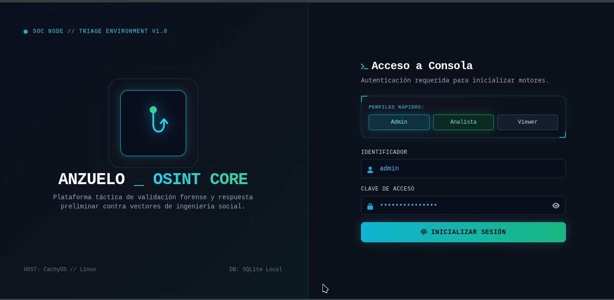
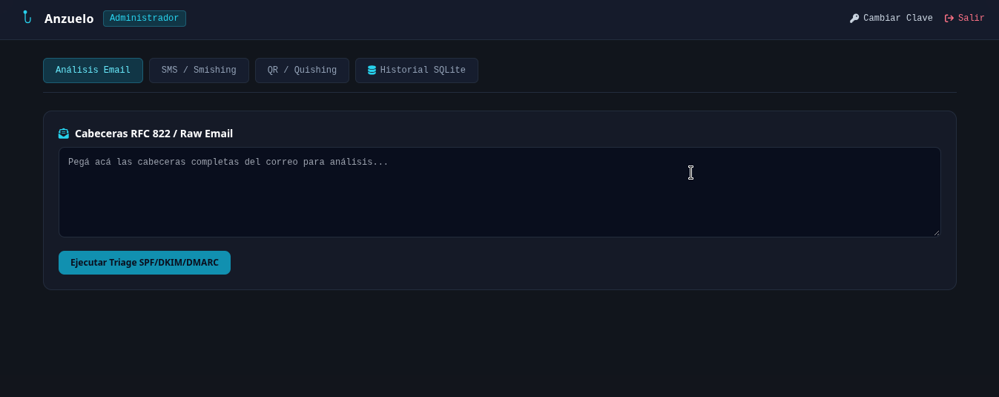
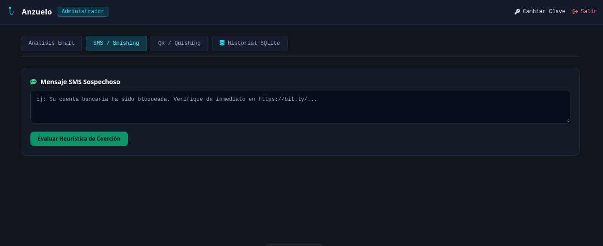
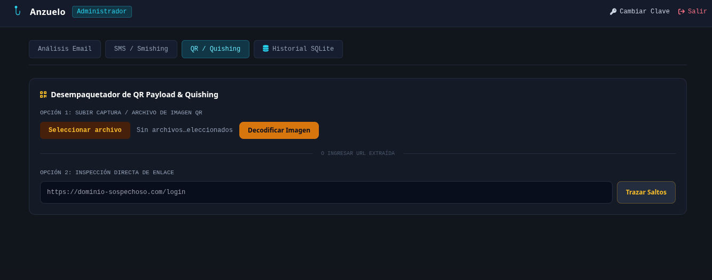
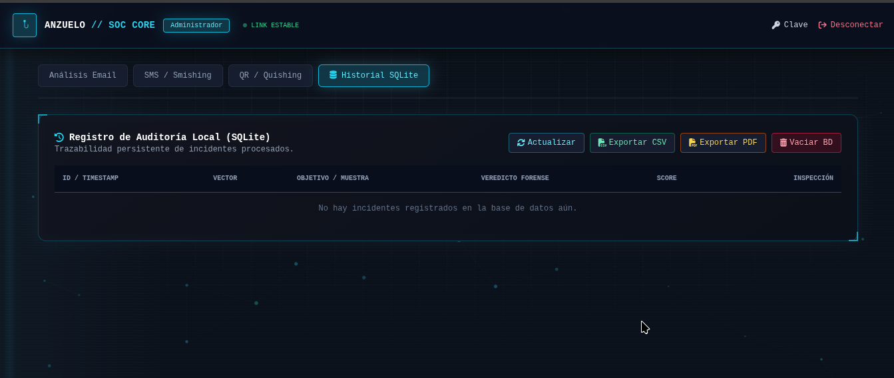

# Anzuelo · OSINT Phishing & Social Engineering Triage Platform


[](https://github.com/N1x-afl/anzuelo-osint/actions/workflows/tests.yml)

Plataforma unificada de respuesta preliminar y análisis forense rápido frente a vectores de ingeniería social (Phishing de correo, Smishing por SMS y Quishing vía códigos QR), orientada a analistas de seguridad, equipos de respuesta a incidentes (CSIRT/SOC) y entornos homelab.

---

## 🎯 Características Principales

- **Análisis Forense de Cabeceras RFC 822 (Email):** Extracción de remitente, saltos SMTP (`Received`) y resolución activa de registros DNS para validación de políticas **SPF**, **DKIM** y **DMARC**.
- **Heurística de Smishing (SMS):** Evaluación de patrones lingüísticos y disparadores de coerción/urgencia con extracción automática de URLs objetivos.
- **Desempaquetador de QR & Trazado de Quishing:** Decodificación directa de matrices QR desde archivos de imagen (PNG, JPG, WEBP) o inspección manual de enlaces, con trazado de cadena de saltos y redirecciones HTTP hasta el destino final.
- **Threat Intelligence Externo (opcional):** Enriquecimiento de dominios, URLs e IPs contra VirusTotal, AbuseIPDB y URLhaus — ver sección dedicada más abajo.
- **Persistencia Local con SQLite:** Registro de auditoría integrado para trazabilidad de incidentes sin dependencias de bases de datos externas.
- **Exportación de Evidencia (CSV / PDF forense):** Historial completo a CSV, informe PDF resumen de todos los incidentes, o informe PDF individual por incidente con hash SHA-256 de integridad (cadena de custodia) — ver sección dedicada más abajo.
- **Autenticación Real + Rate Limiting:** Login respaldado por backend (bcrypt + JWT), roles (admin/analista/viewer) y límite de intentos para frenar fuerza bruta — ver sección dedicada más abajo.
- **Dockerizado:** `Dockerfile` + `docker-compose.yml` listos para levantar todo con un comando, sin instalar Python/zbar en el host.
- **Suite de Tests + CI:** 63 tests automatizados (pytest) cubriendo heurísticas, Threat Intelligence, auth y export, corridos en cada push/PR vía GitHub Actions — ver sección dedicada más abajo.
- **Arquitectura de Proceso Único:** Backend en FastAPI y Frontend (HTML/Tailwind CSS) servidos bajo el mismo socket y proceso, accesible localmente o mediante la IP física de la LAN.
- **Interfaz táctica tipo SOC:** fondo de red animado (nodos conectados sobre Canvas), barrido de radar, esquinas HUD en los paneles y estados de "escaneo" en los botones de acción.

---

## 📸 Capturas de Pantalla

> Las capturas actuales corresponden a una versión previa de la interfaz. La UI fue rediseñada con estética SOC/cyberpunk (fondo de red animado, radar, HUD) — se van a actualizar en el próximo corte.

### 1. Consola de Acceso & Identidad Visual


### 2. Triage de Cabeceras de Correo Electrónico


### 3. Detección Heurística de Smishing


### 4. Decodificación de QR Payload & Quishing


### 5. Registro y Auditoría Local en SQLite


---

## 🛠️ Stack Tecnológico

- **Backend:** Python 3.11+ + FastAPI + Uvicorn
- **Frontend:** HTML5 semántico + Tailwind CSS (CDN) + FontAwesome (CDN)
- **Procesamiento de Imágenes & Códigos:** `Pillow`, `pyzbar` (librería nativa `zbar`)
- **Resolución Forense de Red:** `dnspython`, `requests`, `socket`
- **Threat Intelligence:** VirusTotal API v3, AbuseIPDB API v2, URLhaus API (abuse.ch), WHOIS (`python-whois`) — vía `backend/services/threat_intel.py`, configurables por `.env` (`python-dotenv`)
- **Exportación de Evidencia:** `reportlab` (PDF forense con hash de integridad) y `csv` (stdlib) — vía `backend/services/report_export.py`
- **Autenticación:** `PyJWT`, `bcrypt`, `slowapi` (rate limiting) — vía `backend/services/auth.py`
- **Almacenamiento:** SQLite3 (`anzuelo.db`, local — no versionado en git)
- **Sistema Operativo Base:** CachyOS / Arch Linux

---

## 🚀 Despliegue y Ejecución Rápida

### Opción recomendada: Docker

No necesitás instalar Python, `zbar` ni nada más en tu sistema — todo vive adentro del contenedor.

```bash
git clone https://github.com/N1x-afl/anzuelo-osint.git
cd anzuelo-osint

cp .env.example .env   # opcional, completá las keys de Threat Intelligence que tengas
touch anzuelo.db        # importante: crea el archivo vacío ANTES del primer `up`,
                         # si no Docker monta una carpeta en su lugar y falla

docker compose up -d --build
```

Con eso queda escuchando en `http://localhost:8001`, en segundo plano (el `-d`). `anzuelo.db` vive en tu máquina (montado como volumen), así que el historial de incidentes y los usuarios sobreviven a cada `docker compose up --build` posterior.

**Comandos de uso diario:**

```bash
docker compose up -d        # arrancar (si ya hiciste el build una vez, no hace falta --build de nuevo)
docker compose logs -f      # ver logs en vivo
docker compose down         # parar
docker compose up -d --build   # reconstruir después de bajar cambios nuevos del repo (git pull)
```

**Que quede corriendo solo, incluso después de reiniciar la máquina:** `docker-compose.yml` ya tiene `restart: unless-stopped`, así que una vez que lo levantaste una vez con `docker compose up -d`, Docker lo va a reiniciar solo si se cae o si rearrancás el equipo — **siempre que el servicio de Docker en sí arranque al boot**. Confirmalo (una sola vez) con:

```bash
sudo systemctl enable --now docker
```

Con eso, de ahora en más alcanza con tener la máquina prendida: no hace falta volver a correr `docker compose up` manualmente después de cada reinicio.

### Alternativa: entorno local sin Docker

Si preferís correrlo directo con Python (útil para desarrollo/debug):

**1. Instalar la librería nativa de `zbar`** (la necesita `pyzbar` para decodificar códigos QR):

```bash
# Arch Linux / CachyOS
sudo pacman -S --needed zbar

# Ubuntu / Debian / Linux Mint
sudo apt install libzbar0

# Fedora / RHEL
sudo dnf install zbar
```

**2. Clonar, crear entorno virtual e instalar dependencias:**

```bash
git clone https://github.com/N1x-afl/anzuelo-osint.git
cd anzuelo-osint

python -m venv venv
source venv/bin/activate.fish   # En Fish shell
# source venv/bin/activate      # En Bash/Zsh

pip install -r requirements.txt
```

**3. Arrancar:**

```bash
chmod +x run.sh
./run.sh
```

Igual que con Docker, queda escuchando en `0.0.0.0:8001` — accesible desde `http://localhost:8001` y desde cualquier equipo de la misma LAN por la IP física del host. A diferencia de Docker, acá sí tenés que dejar la terminal abierta (o usar `tmux`/`screen`/un servicio `systemd` propio) para que seguir corriendo.

---

## 🔍 Threat Intelligence (opcional)

Además del análisis heurístico local (SPF/DMARC, patrones de SMS, cadena de redirecciones), Anzuelo puede enriquecer cada triage consultando fuentes externas de reputación:

| Fuente | Qué consulta | Requiere API key | Plan gratuito |
|---|---|---|---|
| [VirusTotal](https://www.virustotal.com/gui/join-us) | Reputación de dominio y de URL (cuántos motores antivirus la marcan) | Sí | ~4 req/min |
| [AbuseIPDB](https://www.abuseipdb.com/register) | Score de abuso de la IP resuelta (0-100) | Sí | 1000 req/día |
| [URLhaus](https://urlhaus.abuse.ch/) (abuse.ch) | Si la URL está en su base pública de malware/phishing | Sí (desde 2025) | Gratuita, [auth.abuse.ch](https://auth.abuse.ch/) |
| WHOIS | Edad del dominio (días desde su registro) y registrador — un dominio recién creado es una señal fuerte de phishing | No | Protocolo público (puerto 43) |

**La app funciona igual sin ninguna key configurada** — cada fuente no configurada se muestra como "no disponible" en el resultado y no afecta el resto del análisis.

Para activarlas:

```bash
cp .env.example .env
# Editá .env y completá las keys que tengas
```

El `risk_score` de cada vector (Email, URL, QR) incorpora estas señales cuando están disponibles: un dominio/URL marcado como malicioso en VirusTotal, una IP con score alto en AbuseIPDB, o una URL encontrada en URLhaus suman directamente al puntaje de riesgo.

---

## 📄 Exportación de Evidencia (CSV / PDF)

Pensado para quien necesite anexar el triage a un reporte de incidente, un ticket, o un expediente con requisitos de trazabilidad (p. ej. ISO 27001:2022, control A.5.25 "Evaluación y decisión sobre eventos de seguridad de la información"):

| Export | Endpoint | Contenido |
|---|---|---|
| CSV del historial completo | `GET /api/export/csv` | Todas las filas del historial, con columna de hash SHA-256 por registro |
| PDF resumen del historial | `GET /api/export/history/pdf?analyst=<nombre>` | Tabla de todos los incidentes, con el perfil que lo exportó |
| PDF de un incidente puntual | `GET /api/export/incident/{id}/pdf?analyst=<nombre>` | Informe forense completo: resumen, detalle técnico (incluye Threat Intelligence) y **hash SHA-256 de integridad** |

El hash de integridad se calcula sobre el JSON canónico del incidente tal como quedó guardado en SQLite — permite verificar más adelante que el PDF exportado no fue alterado respecto al registro original (cadena de custodia básica).

Los tres se generan localmente con `reportlab` — sin llamadas a servicios externos. Disponibles desde la pestaña **Historial SQLite** (botones "Exportar CSV" / "Exportar PDF") y desde el inspector de detalle de cada incidente ("Exportar Informe PDF").

---

## 🔐 Autenticación

Desde esta versión, el login es **autenticación real del lado del backend**, no una puerta de entrada de frontend:

- Claves guardadas con **bcrypt** (nunca en texto plano) en una tabla `users` dentro de `anzuelo.db`.
- Sesión vía **JWT firmado** (`Authorization: Bearer <token>`), expira a las 8hs por defecto (`ANZUELO_JWT_EXPIRE_MINUTES` en `.env`).
- Todos los endpoints de análisis, historial y export requieren sesión válida; vaciar el historial (`DELETE /api/history`) requiere además rol **admin**.
- **Rate limiting** (vía `slowapi`) en login y cambio de clave: 5 intentos/minuto por IP, para frenar fuerza bruta. Los endpoints de análisis están limitados a 20 req/minuto.
- Podés cambiar tu clave desde la UI (botón "Clave" en el header) una vez logueado.

La tabla `users` se siembra automáticamente la primera vez que corre `init_db()`, con los mismos 3 perfiles demo que ya conocías — pero ahora son usuarios reales validados en el backend, no un hardcode del frontend:

| Perfil | Usuario | Clave inicial |
|---|---|---|
| Admin | `admin` | `admin123` |
| Analista OSINT | `analista` | `analista123` |
| Visualizador | `viewer` | `viewer123` |

**Recomendado si vas a usarlo más allá de pruebas locales:** cambiá estas 3 claves apenas lo levantes (botón "Clave"), y fijá un `ANZUELO_JWT_SECRET` propio en `.env` — si no lo configurás, se genera uno aleatorio en cada arranque del backend, lo que invalida todas las sesiones activas cada vez que reiniciás el proceso.

## ⚠️ Otras Notas de Seguridad (leer antes de exponerlo fuera de tu red local)

Anzuelo está pensado para uso personal/homelab, no como servicio expuesto a internet sin revisión adicional:

- **CORS está abierto a cualquier origen** (`allow_origins=["*"]`) en `backend/main.py`, pensado para desarrollo local y acceso LAN. Si lo exponés más allá de tu red de confianza, restringilo a los orígenes que realmente necesites.
- **`anzuelo.db` queda en tu máquina y no se sube al repo** (está en `.gitignore`), ya que acumula el historial real de incidentes/correos/SMS que analices — y ahora también las claves (hasheadas) de los usuarios.

---

## 🧪 Tests

La suite cubre heurísticas de análisis (email/SMS/URL/QR), las 4 integraciones de Threat Intelligence, autenticación/roles/rate limiting y la exportación de evidencia — 63 tests en total, corridos automáticamente en cada push/PR a `main` vía [GitHub Actions](.github/workflows/tests.yml).

Todo lo que toca red externa (DNS, WHOIS, VirusTotal, AbuseIPDB, URLhaus) está mockeado, así que la suite corre rápido y determinística sin necesitar conectividad ni API keys reales.

```bash
pip install -r requirements-dev.txt
pytest -v
```

| Archivo | Qué cubre |
|---|---|
| `tests/test_analyzer.py` | Heurísticas de email/SMS/URL/QR (`ForensicAnalyzer`), incluyendo cálculo de `risk_score` |
| `tests/test_threat_intel.py` | VirusTotal, AbuseIPDB, URLhaus, WHOIS — degradación sin key, errores de red, matches positivos |
| `tests/test_auth_service.py` | Hashing bcrypt, emisión/validación de JWT, tokens vencidos o adulterados |
| `tests/test_report_export.py` | Generación de CSV/PDF, hash de integridad |
| `tests/test_api.py` | Integración end-to-end vía `TestClient`: login, roles, rate limiting, y los flujos de análisis/historial/export completos |

---

## 🛡️ Licencia y Propósito

Este software ha sido desarrollado con propósitos educativos, de investigación OSINT y respuesta defensiva ante incidentes.

Distribuido bajo licencia [MIT](LICENSE).
